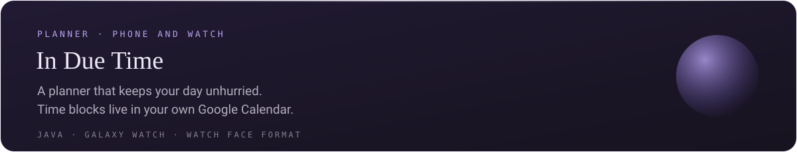
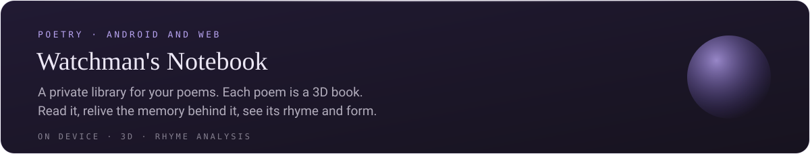
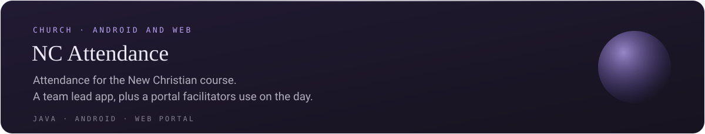
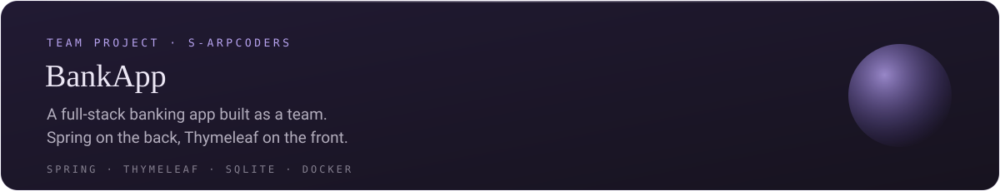

  

### About

I'm a developer in Johannesburg.
I build apps that slow you down instead of speeding you up.
One moment per screen. No feeds, no streaks.
Your data stays on your device.

I also design and edit video, so I draw every screen before I build it.

### Building now

Watchman's Notebook and NC Attendance are private for now.

### Earlier work

### How I build

  

- Kotlin and Jetpack Compose first. A web version when iPhone users need it.
- Signed Android builds without Gradle, using aapt2, javac and dx.
- Phone, tablet, DeX and Galaxy Watch.
- Every app follows one design standard: dark first, calm motion, one clear action.

### Reach me

